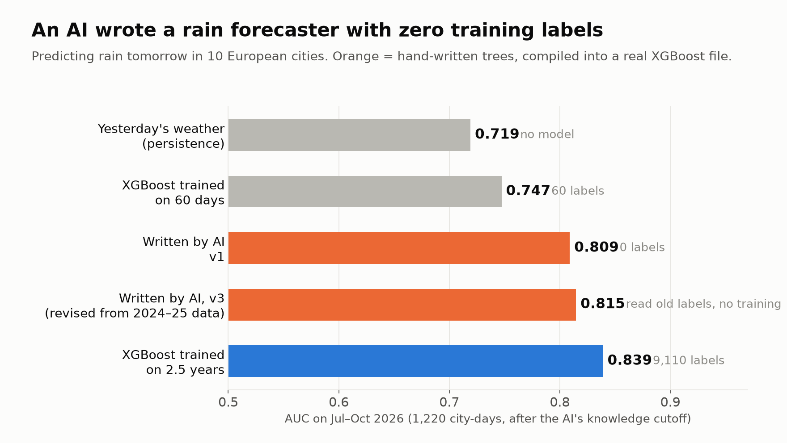
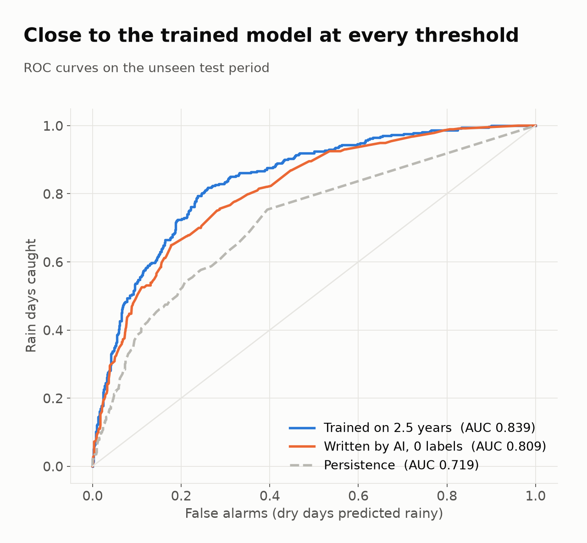
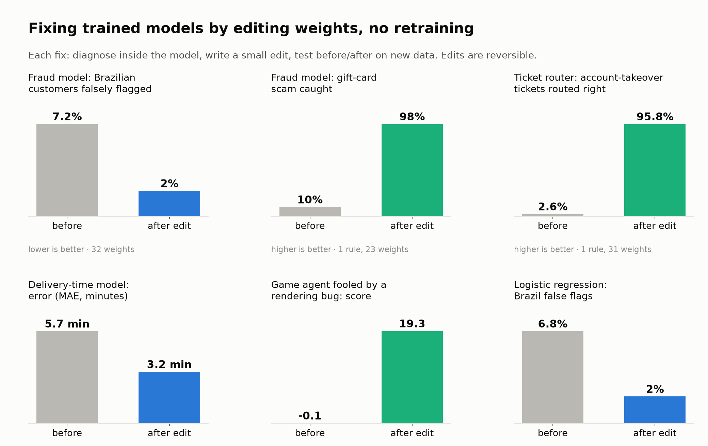
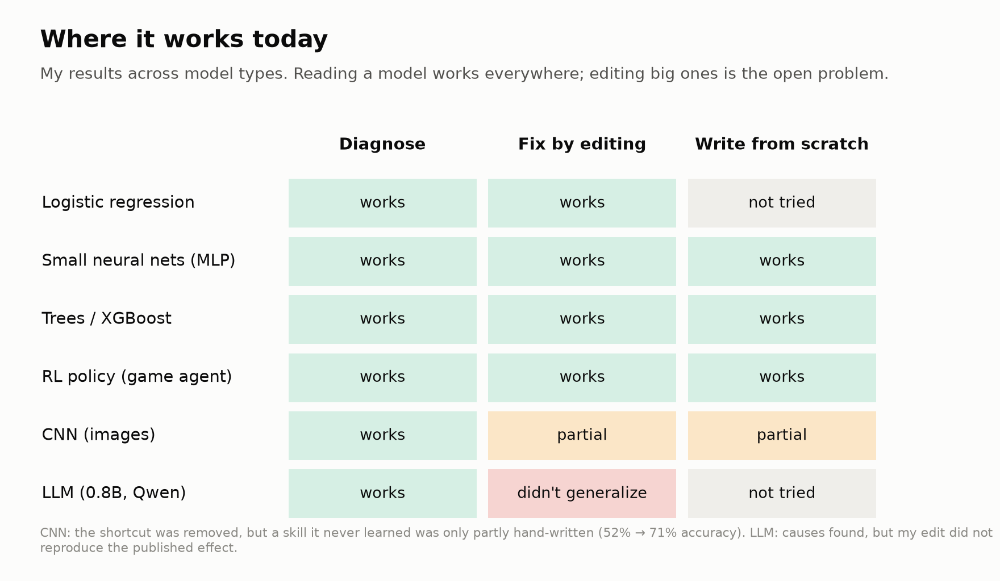
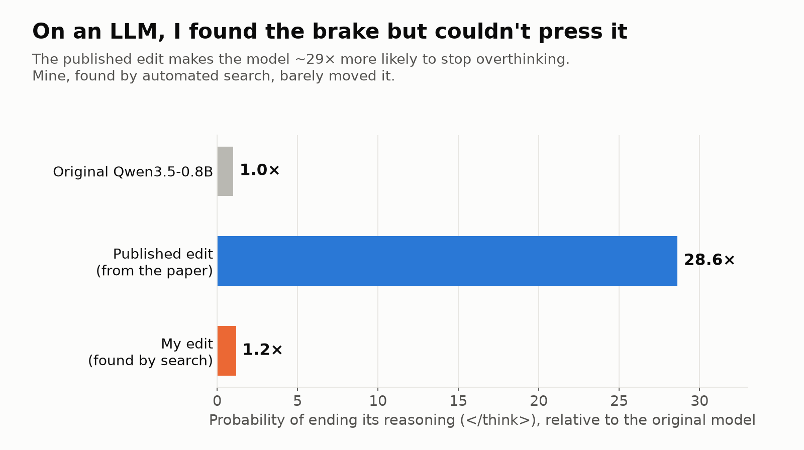

A few days ago, MIT CSAIL researchers published [Sparks of Weight-Space Programming](https://rikiyat.github.io/blog/weight-space-programming/): a frontier model that reads a neural network's weights and edits them directly, with no gradient descent, to change its behavior.

That's a big claim. If it holds, models stop being black boxes you retrain and become something closer to code: you read them, patch them, review the diff.

So I tested it. Over a few days I used an AI coding agent as a "model engineer": it inspected models, wrote edits to their weights, tested them on held-out data, and versioned every change. I tried logistic regression, small neural nets, gradient-boosted trees, an RL agent, a CNN and a small LLM.

**Short version:** on classic and small models, it works, sometimes remarkably well. On LLMs, finding the cause inside the model works; writing an edit that holds up doesn't (yet).

---

## 1. The result that surprised me: a model written with zero labels

The usual way to get a model: collect labelled data, train. I tried the opposite. No labels, no training. The AI writes the model from what it knows.

**Task:** will it rain (≥ 1 mm) tomorrow in 10 European cities, given today's weather (pressure, pressure change, humidity, cloud, wind, rain today…), using public [Open-Meteo](https://open-meteo.com/) data.

**The catch that makes it fair:** the test period is **July–October 2026, after the AI's knowledge cutoff**. It cannot have memorised the answers.

The AI wrote the model as a small program of decision trees, each with a reason attached:

```json
{"why": "falling barometer = low approaching; rising = high building",
 "if": ["pressure_change_24h", "<", -3.4],
 "then": {"if": ["pressure_change_24h", "<", -7.2], "then": 1.1, "else": 0.6},
 "else": {"if": ["pressure_change_24h", ">", 3.4], "then": -0.7, "else": 0.0}}
```

The only data it was allowed to look at was **unlabelled**: feature percentiles, so "low pressure" can be written as `"p20"` instead of guessing hPa values. A small compiler turns this program into a **standard XGBoost model file**, which loads in stock XGBoost like any trained model.



- **Written with zero labels: AUC 0.809.**
- XGBoost trained on 2.5 years (9,110 labelled days): 0.839.
- XGBoost trained on 60 labelled days: 0.747.
- "Tomorrow = today" persistence: 0.719.

The hand-written model recovers about **75% of the gain** that 2.5 years of training gives over persistence, and it beats a model trained on two months of data.



In a second round, I let the AI read 2024–25 labels (diagnostics only, still no training), revise its trees, and validate on Jan–Jun 2026 before a single final test run. That moved AUC from 0.809 to 0.815 and log-loss from 0.493 to 0.479. It's a modest gain, and along the way I caught a bug in my own analysis script (averaging log-odds where I meant probabilities), which led to the calibration fix.

**Caveats, honestly:**
- The trained baseline is a reasonable but untuned XGBoost. A tuned one would widen the gap.
- With plenty of data, training is still cheaper and better. The interesting case is **day one, before any data exists**, or when data is scarce.
- On a famous dataset (breast cancer), a written model reached AUC 0.972 vs 0.985 trained, but that dataset may be memorised, so I lead with the rain test.

---

## 2. Fixing trained models by editing weights

The second question: when a trained model has a flaw, can you fix it by editing it directly instead of retraining?

Each experiment followed the same loop:
1. **Diagnose** inside the model: which inputs and units drive the bad behavior.
2. **Write a small edit**: change a few weights, or add a "rule block" (a tiny gated sub-network that only fires when its conditions hold).
3. **Test before/after** on new data, per segment, and flag any regression.
4. **Commit** it as a reversible patch: the base model is never modified, and the current model = base + active patches.



*(The fraud, router and delivery-time models were trained on synthetic data I generated with a realistic flaw built in, so the "right answer" is known.)*

**A fraud model biased against one currency.** It had learned from old data that Brazilian real transactions were 3.9× riskier; recent data says 1.2×. The edit shrinks that input's weights toward the real level. 32 weights changed; false flags on BRL fell from 7.2% to 2.0%, and overall AUC *improved* (0.817 → 0.837). The regression check did flag one trade-off: fraud caught *within* BRL fell from 53% to 31%, because part of those "catches" came from the bias itself. Across all currencies, fraud caught rose from 19% to 24%.

**A new scam, added the same day.** "Gift card AND amount > $500" was a new pattern the model had never seen. Instead of retraining, I added a new input and a rule block: 23 weights. Catch rate on that scam went from 10% to 98%, and **nothing outside the rule changed**.

**A ticket router with an old habit.** A 4-class PyTorch router kept sending enterprise customers' technical tickets to account managers (an outdated policy), and missed account-takeover tickets. Two patches took takeover tickets from 2.6% to 95.8% correctly routed; the other tickets' outputs moved by less than 1e-7, and no other prediction flipped.

**Trees.** The easiest case. In a gradient-boosted model you can neutralise a feature by editing split thresholds, or append a hand-written tree. The edited XGBoost JSON still loads in stock XGBoost.

**An RL agent that learned a bug.** A game agent (catch a falling ball) was trained in an environment with a rendering bug: a "shadow" showing where the ball would land. The agent learned to follow the shadow. Remove the bug and it scores −0.1. I hand-wrote a small circuit that *computes* the shadow from the ball's position and direction, and grafted it into the agent's inputs: score +19.3, vs +19.4 originally. (Honestly: retraining this toy is also cheap. The point is that the repair was exact and explainable.)

### Lessons from the failures along the way

- **Copy a real reference, not an average.** In a small neural net, setting the biased currency to "the average of all currencies" failed: nonlinear units don't average. Setting it to behave like one real comparable currency (USD) worked.
- **Weight size lies.** Big weights aren't necessarily what matters. Behavioral tests on real data were the only reliable guide.
- **Don't guess the architecture.** Importing a PyTorch state_dict with BatchNorm, a guessed layer order produced a model that loaded fine and was silently wrong. Now the tool refuses and asks for the layout.

---

## 3. Where it breaks



### You can't edit in a skill the model never learned

A CNN learned a shortcut: a camera stamp that correlated with one class. Zeroing 32 weights removed the shortcut completely, but accuracy stayed at **52%**, because without the shortcut the model had never learned the actual shapes. Hand-writing a straight-edge detector (40 weights) brought it to 71%. Partial.

**Editing removes or redirects behavior; it doesn't easily add knowledge.**

### LLMs: finding the cause works, the edit doesn't hold up

The MIT post's showcase edit makes Qwen3.5-0.8B stop overthinking (end its reasoning earlier). I verified their released edit: it makes the end-of-reasoning token about **29× more likely**.

Then I tried to find such an edit myself, with a 0.8B model on a laptop. I found real directions linked to stopping, and an automated search over layers picked the three that moved the stop probability most on my search set. On a held-out measurement, my edit moved it **1.2×**. Effectively nothing.



This matches what others replicating the paper report: diagnosis transfers, edits often don't. The MIT result used a frontier model doing the editing; doing it reliably is still an open problem.

---

## So what is this, really?

My takeaway after all of this:

1. **Reading a model works on every model I tried**, including the LLM. That alone is useful: explaining why a model does something, from inside the model, not from guesses.
2. **Editing works today on classic and small models**: fraud, credit, pricing, routing, forecasting. Those are most of the models running in production. Fixes take minutes instead of a retraining cycle, they're precise, reversible and explainable.
3. **Writing models from knowledge is real**, at least for tabular problems. It gives you a working model on day one, then you correct it as labels arrive.
4. **Large models are the frontier.** You can read them but not reliably patch them yet. That gap probably shrinks with each generation of AI models.

The bigger idea is that models stop being compiled blobs you re-cook with more data, and become source code: something you can read, diff, review, test and patch. We built git, code review and CI for code. Models will need the same layer.

---

*The tooling: a small CLI that imports PyTorch, scikit-learn and XGBoost models, exposes inspection tools (feature effects, unit activity, weights), applies JSON edit ops (`shrink_input_toward`, `project_out`, `add_rule`…), runs before/after evals per slice, and exports back to PyTorch (`torch.export`), scikit-learn or XGBoost. Code: [link].*

*If you have a model with a flaw you'd like to try this on, I'd love to hear from you.*
